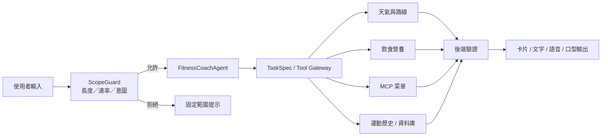

# 🏃 AI Fitness Coach｜領域智慧健身教練

> 以自然語言對話為入口，整合慢跑規劃、天氣路線、飲食營養與運動紀錄的 Domain AI Agent 專題。

   

> **目前狀態**：此 Repository 尚無程式碼；以下依專題解析文件整理為設計與開發規劃，不代表功能已完成。

## 01｜專案簡介

**AI Fitness Coach** 致力於打造以「對話式慢跑教練」為核心的網頁平台，讓使用者不必操作繁瑣表單，就能透過自然語言取得運動建議、查詢天氣與路線、分析飲食營養，並管理運動紀錄。

本專題以 **Domain AI Agent（領域智慧代理人）** 為定位，而非單純聊天機器人。規劃使用單一 `FitnessCoachAgent`、工具調用流程及領域資料來源，將對話轉換為具體任務。

## 02｜Domain AI Agent 四大要素

| 要素 | 設計內容 |
| --- | --- |
| **AI Agent** | 單一 `FitnessCoachAgent` 搭配 `Tool Gateway` 與 `Tool Loop`，負責意圖處理及工具調用 |
| **Domain Knowledge** | 慢跑計畫、中央氣象署（CWA）天氣、食品營養成分資料、MCP 菜單與過敏原篩選 |
| **Data Analytics** | 有效運動時間、公里配速、食物營養與熱量換算、歷史 Snapshot |
| **Real-World Application** | 以 Vercel 與 Supabase 等服務規劃可公開連線且重視資料隔離的網頁系統 |

## 03｜核心功能

| 功能 | 預計提供的能力 |
| --- | --- |
| 💬 AI 教練對話 | 以「今天想跑 30 分鐘」等自然語言需求，產生暖身／慢跑／收操計畫 |
| 🌦️ 天氣與路線 | 查詢環境條件與路線資訊，輔助跑前規劃 |
| 🥗 飲食營養分析 | 依食物和份量估算營養、熱量，並可修正辨識內容 |
| 🍽️ MCP 菜單建議 | 呼叫菜單推薦與過敏原篩選工具 |
| 📊 運動歷史 | 記錄有效時間、距離、配速及歷史結果 |
| 🗣️ 語音與數位人像 | 規劃文字、語音及口型回饋，並提供服務故障時的降級顯示 |

### 典型使用流程

1. 使用者詢問：「今天想跑 30 分鐘」。
2. `ScopeGuard` 檢查輸入長度、速率與服務範圍。
3. `FitnessCoachAgent` 形成結構化任務，視需求調用天氣、路線等工具。
4. 後端驗證結果並輸出運動建議。
5. 使用者確認計畫，完成運動後保存紀錄。

## 04｜系統架構



### 技術規劃

| 層級 | 預計技術 | 職責 |
| --- | --- | --- |
| Frontend | Vanilla JS（ES Modules） | 對話介面、互動卡片 |
| Backend | Python / FastAPI | API、Agent、工具調度與業務邏輯 |
| Database | Supabase PostgreSQL | 使用者與運動、飲食資料 |
| Storage | Supabase Storage | 檔案與相關資產 |
| Realtime | WebSocket | 對話和語音事件串流 |
| Deploy | Vercel、相容後端部署服務 | 對外提供系統 |
| AI | LLM / Function Calling / MCP | 理解意圖與呼叫領域工具 |

實際模型供應商、免費額度與部署方式將於初期可行性驗證後確定。

## 05｜設計重點與安全機制

### ScopeGuard

在請求進入 LLM 之前，以非 LLM 的程序檢查長度、速率與意圖。對超出服務範圍的內容回傳固定提示，降低無謂的 Token 消耗及濫用風險。**ScopeGuard 並不能單獨保證防止 Prompt Injection**；工具權限、輸入驗證、身分授權與後端檢核仍不可省略。

### Tool Gateway

由 Agent 產生 `TaskSpec`，經受控工具入口呼叫外部資料、MCP 服務或資料庫。後端需檢查參數、使用權限與回傳結果，不直接信任模型輸出。

### Budget Control

規劃以單回合 Token 上限、每日配額、工具迭代次數及原子更新機制控制成本，降低免費雲端環境中的超額風險。

### 降級備援

當語音或口型服務不可用時，退回文字訊息或待機圖，維持核心互動能力。

## 06｜資料分析

### 運動配速

```text
有效運動秒數 = 總運動秒數 - 暫停秒數
每公里配速（秒／公里） = 有效運動秒數 / 距離（公里）
```

計算時必須先確認距離大於零；結果可呈現為 `mm:ss / km`。

### 飲食 Snapshot

根據食物種類、份量及營養資料估算熱量，並將當次換算結果保存為歷史 Snapshot，避免來源資料更新後改變已記錄的分析結果。

## 07｜品質與驗證目標

**下列數字為專題規劃目標，非目前實測結果。**

| 項目 | 規劃目標 |
| --- | --- |
| 一般查詢 P95 延遲 | < 2 秒 |
| 文字回覆 P95 延遲 | < 8 秒 |
| 語音回覆 P95 延遲 | < 12 秒 |
| 停止播放反應 | < 300 毫秒 |
| 工具迭代上限 | 3 次 |
| 單回合 Token 預算 | 10,000 |
| 音訊最長時間 | 20 秒 |
| 每日使用量 | 依供應商額度設定 |

預計進行單元測試、整合測試、ScopeGuard 拒絕測試、真機測試、免費額度模擬及端到端驗收。展示情境規劃包含登入、天氣路線查詢、採用運動計畫、飲食照片修正與歷史紀錄讀回。

## 08｜開發里程碑（M0–M4）

以下為依專題規劃整理的階段性工作清單，並非已完成項目：

- [ ] **M0 可行性驗證**：確認 LLM、語音服務、免費額度及部署限制。
- [ ] **M1 基礎架構**：建置前後端、資料庫、身分驗證與 ScopeGuard。
- [ ] **M2 核心 Agent**：實作 TaskSpec、Tool Gateway、運動計畫與紀錄。
- [ ] **M3 領域服務整合**：串接天氣、路線、營養、MCP 與語音回饋。
- [ ] **M4 完整驗收**：執行整合測試、效能量測、雲端部署與文件交付。

### 未來擴充

- 手機瀏覽器持續 GPS 追蹤。
- 計步及姿態感測。
- 長期個人化記憶與運動建議。

## 09｜開發文件與啟動方式

目前 Repository 尚未建立程式碼，因此暫不提供未經驗證的安裝及啟動指令。後續應補充環境需求、環境變數範例、前後端啟動命令、測試方法及部署流程。

建議維護的文件（**目前僅為規劃，非已存在的檔案**）：

| 文件 | 用途 |
| --- | --- |
| `proposal.md` | 研究動機、背景及專題提案 |
| `DESIGN.md` | 系統架構、資料流與安全設計 |
| `uxd.md` | 使用者體驗與互動流程 |
| `contracts/` | API、資料與事件契約 |
| `THIRD_PARTY_NOTICES.md` | 第三方元件與授權資訊 |

## 10｜專題價值

AI Fitness Coach 希望將 **領域知識、資料分析、工具調用、風險控管與雲端部署** 整合為可驗證、可擴充的智慧健身教練：讓對話不只產生文字回答，而是引導使用者完成運動規劃、環境查詢、營養分析及紀錄管理。

---

*本 README 依「AI 健身教練解析」文件整理。功能狀態與系統細節，應以後續實際程式碼和驗收結果為準。*
